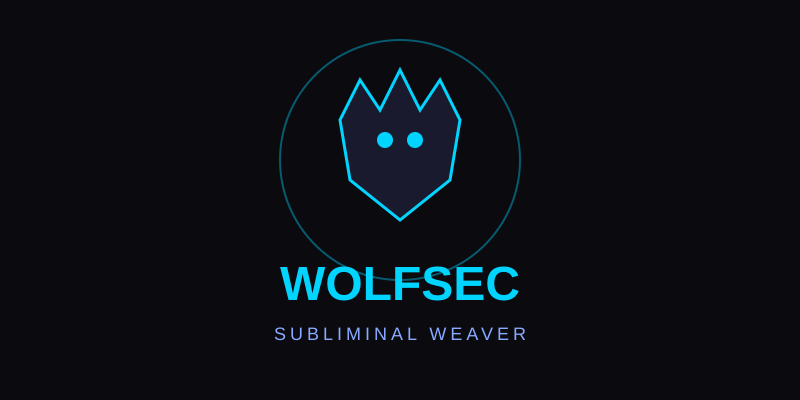

# 🐺 Subliminal Weaver



**WolfSec / DebianGang edition**

Open-source steganography tool for embedding and extracting messages in images and audio.  
Local-only. No telemetry. Built for creators, musicians, and researchers.

> Permanent hosted demo: Coming soon on Hugging Face Spaces (see below).

## Features

- LSB steganography for PNG / BMP images
- LSB steganography for WAV audio
- Optional password encryption (Fernet / PBKDF2)
- Basic analysis: LSB plane visualization and simple transition score
- Capacity calculator
- Expanded Gradio web UI (dark theme, capacity, analysis, audio support)
- CLI

## Quick Start (local)

```bash
git clone https://github.com/masterxhackerx420-oss/subliminal-weaver
cd subliminal-weaver
pip install -r requirements.txt
python web_ui.py          # web UI
# or
python weaver.py --help   # CLI
```

## Host permanently (Hugging Face Spaces — free public link)

1. Create a free account at https://huggingface.co
2. Go to https://huggingface.co/new-space
3. Name it `subliminal-weaver`, choose **Gradio** SDK, set public.
4. In the Space, add these files (or connect the GitHub repo):
   - `app.py` (already prepared in this repo — it launches the UI)
   - `requirements.txt`
   - the `core/` folder
5. The Space will build and give you a permanent public URL like:
   `https://huggingface.co/spaces/masterxhackerx420-oss/subliminal-weaver`

Temporary share link (from your machine):
```bash
# edit web_ui.py launch line to: demo.launch(share=True)
python web_ui.py
```

## Responsible Use

For creative projects, personal privacy, and research. Do not use to conceal illegal content.

## License

MIT
